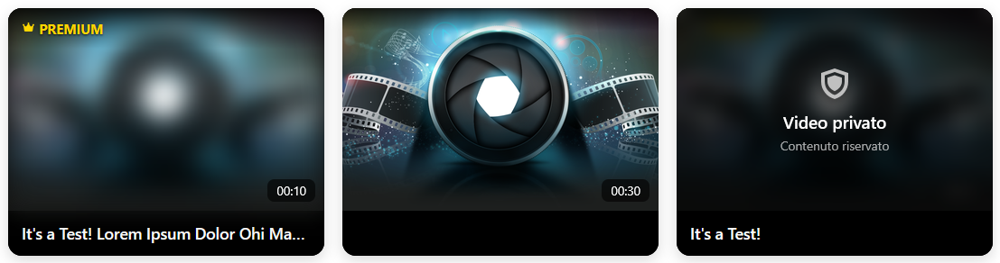
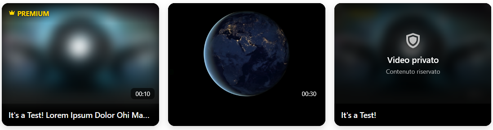
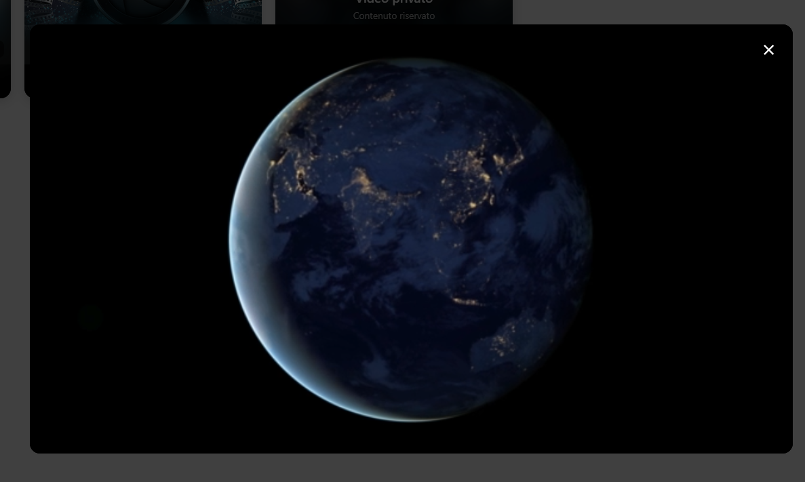
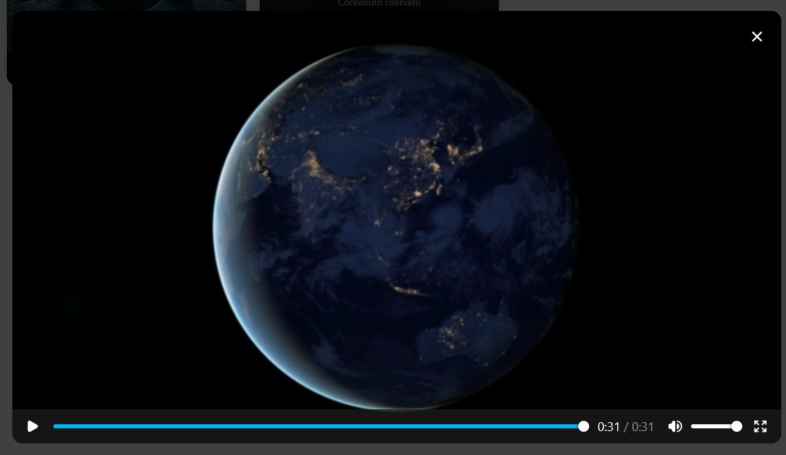

# VideoRM

Mini libreria JavaScript, senza dipendenze, per creare una galleria di video con anteprima al passaggio del mouse e player in finestra modale.

**[Guarda la demo](https://a35g.github.io/VideoRM/)**

|  | 
| :---: | :---: |
| Galleria Video | Anteprima all'hover |

|  | 
| :---: | :---: |
| Visualizzazione Video | Video in Modal nativa |

## Caratteristiche

- Nessuna dipendenza: un file JavaScript e un file CSS.
- Anteprima muta al passaggio del mouse: un estratto per i video corti, una sequenza di spezzoni per quelli lunghi.
- Player in un `<dialog>` nativo, con chiusura tramite pulsante, `Esc` o click sullo sfondo.
- Caricamento lazy dei metadati (la durata viene letta solo quando la card si avvicina allo schermo).
- Accessibile da tastiera: `Tab`, `Invio` e `Spazio` sulle card riproducibili.
- Scarto automatico dei video non validi, con errore leggibile in console.
- Titoli inseriti come testo, non come HTML.

## Avvio rapido

Struttura minima dei file:

```
tuo-sito/
├── index.html
└── src/
    ├── css/videorm-style.css
    └── js/videorm-core.js
```

Esempio completo di `index.html`:

```html
<link rel="stylesheet" href="./src/css/videorm-style.css">

<div id="gallery"></div>

<dialog id="videoModal">
  <div class="modal-content">
    <button class="close" id="closeVideo" aria-label="Chiudi">×</button>
    <video id="videoPlayer" controls playsinline></video>
  </div>
</dialog>

<script src="./src/js/videorm-core.js"></script>
<script>
  const gallery = VideoRM({
    contentId: "gallery",
    dataVideo: [
      { video: "video.mp4", title: "Il mio video", typev: "free", cover: "cover.jpg" }
    ]
  });
</script>
```

Servono quindi un contenitore `<div>` e un `<dialog>` con player e pulsante di chiusura. Gli ID di questi elementi si possono cambiare con le opzioni (vedi sotto).

## Riferimento

### Elementi di `dataVideo`

| Campo   | Obbligatorio | Descrizione |
|---------|--------------|-------------|
| `video` | sì           | URL del file video. Se manca o non si carica, la card viene scartata. |
| `title` | no           | Titolo mostrato sotto l'anteprima. Può essere vuoto. |
| `typev` | no           | `free` (predefinito), `premium` o `private`. |
| `cover` | no           | Immagine di copertina. Se omessa si usa `defaultCover`. |

### Opzioni

| Opzione | Predefinito | Descrizione |
|---------|-------------|-------------|
| `contentId` | `"video-content"` | ID del `<div>` che ospita le card. |
| `dataVideo` | `[]` | Elenco dei video. |
| `showPremium` | `true` | Mostra o nasconde le card premium. |
| `showPrivate` | `true` | Mostra o nasconde le card private. |
| `defaultVideoType` | `"free"` | Tipo usato quando `typev` non è indicato. |
| `defaultCover` | `"./src/img/poster/default.png"` | Copertina di riserva. |
| `modalId` | `"videoModal"` | ID del `<dialog>`. |
| `playerId` | `"videoPlayer"` | ID del `<video>` dentro il dialog. |
| `closeId` | `"closeVideo"` | ID del pulsante di chiusura (facoltativo). |
| `serverSide` | `false` | Riservata, al momento non utilizzata. |

Le opzioni si impostano alla creazione dell'istanza. Per cambiarle bisogna chiamare `destroy()` e creare una nuova istanza.

### API

`VideoRM(options)` restituisce un oggetto con due metodi:

| Metodo | Descrizione |
|--------|-------------|
| `render(items)` | Ridisegna la galleria con una nuova lista. Senza argomenti usa `dataVideo`. Con una lista vuota mostra il messaggio "Nessun video disponibile". |
| `destroy()` | Ferma le anteprime, rimuove le card e i listener registrati sul modale. |

```js
gallery.render(nuovaLista);
gallery.destroy();
```

## Comportamento

- **Free**: cliccabili, con anteprima al passaggio del mouse.
- **Premium e private**: visibili ma non riproducibili e senza anteprima. Per ora non sono gestite oltre a questo.
- **Video non valido**: un video senza `video` viene ignorato; uno che non si carica viene rimosso dalla galleria. Vale per tutte le tipologie. L'errore compare in console, con indice, titolo, tipo, motivo e URL:
  ```
  [VideoRM] dataVideo[1] "Titolo" (free) rimosso: formato o sorgente non supportati / non trovati (./video.mp4)
  ```
  Se non resta nessuna card, compare il messaggio "Nessun video disponibile".
- **Anteprima**: parte solo con il mouse. Su touch il tap apre direttamente il player. I video fino a 15 secondi vengono riprodotti dall'inizio (al massimo 10 secondi); quelli più lunghi mostrano 4 spezzoni da 2,5 secondi distribuiti lungo il video.
- **Titolo**: inserito con `textContent`, quindi l'HTML e i caratteri speciali vengono mostrati come testo.

## Personalizzazione CSS

Classi principali di ogni card:

| Classe | Elemento |
|--------|----------|
| `.vds` | Card (con `data-type="free\|premium\|private"`) |
| `.media-wrapper`, `.uvd` | Contenitore e `<video>` dell'anteprima |
| `.top-badge`, `.badge-text` | Etichetta in alto (premium / privato) |
| `.time-display`, `.duration` | Durata in basso a destra |
| `.title-display`, `.title-text` | Titolo |
| `.private-cover` | Copertura delle card private |
| `.vds-empty` | Messaggio di lista vuota |

Due accorgimenti utili:

```css
/* puntatore del mouse a forma di mouse solo sulle card riproducibili */
.vds[data-type="free"] { cursor: pointer; }

/* mantiene l'altezza di una riga anche con titolo vuoto */
.vds .title-text { line-height: 1.4; min-height: 1.4em; }
```

## Compatibilità

La libreria usa `<dialog>`, pointer events, `IntersectionObserver` (con fallback se assente), `replaceChildren`, l'opzione `signal` di `addEventListener` e l'operatore `??=`. Servono quindi browser moderni; indicativamente Chrome e Edge 90+, Firefox 98+ e Safari 15.4+. Verifica le versioni minime sulle tabelle di compatibilità prima di dichiararle come requisito definitivo.

## Limiti noti

- Premium e private non sono ancora gestiti oltre alla visualizzazione non cliccabile.
- L'opzione `serverSide` non è ancora implementata.
- Più istanze nella stessa pagina possono condividere lo stesso `<dialog>`; ogni istanza registra comunque i propri listener su di esso.
- Le opzioni non si cambiano dopo la creazione dell'istanza.

## Licenza

MIT — [LICENZA](LICENSE)
